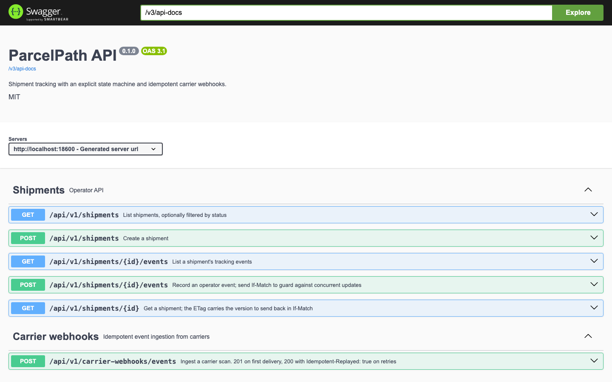
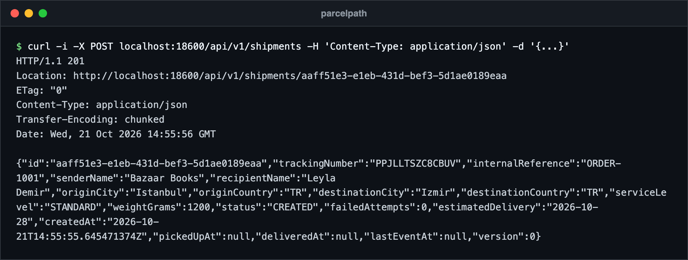
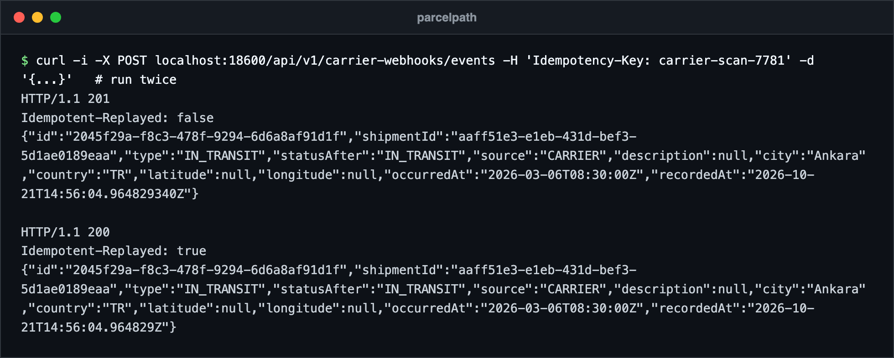
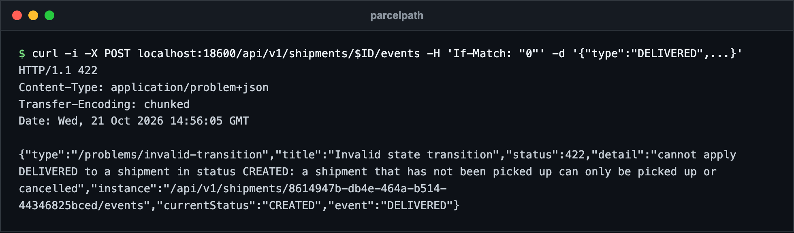
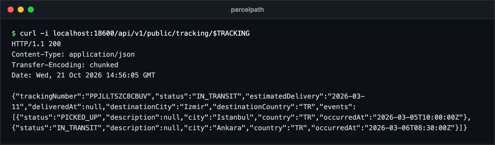
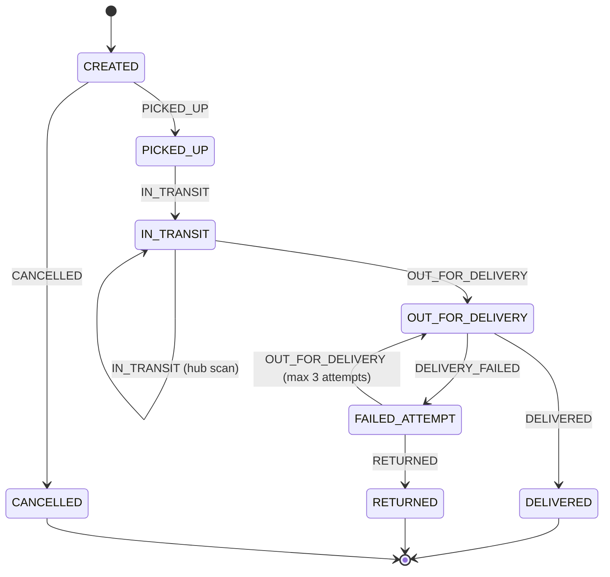
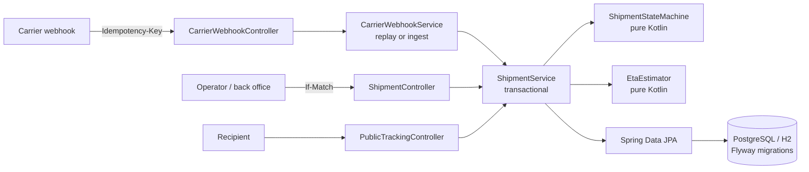

# ParcelPath

A shipment-tracking API for logistics, built with Kotlin and Spring Boot 3.

ParcelPath models the part of a delivery platform that tends to go wrong first: a parcel's
lifecycle. Carriers send scans late, twice, or out of order; two operators edit the same
shipment at once; a recipient's tracking page must never show internal data. This project
handles each of those explicitly and keeps the rules in a small, framework-free domain layer
that is easy to read and test.

## Screenshots

The public tracking view is a JSON endpoint, so it is shown as a real request and response. All captures come from the built jar running locally with the in-memory H2 database and a few seeded requests, not production data.



Swagger UI served by the app at `/swagger-ui.html`.



Creating a shipment returns 201, the tracking number and an `ETag` holding the version.



The same carrier scan sent twice with one `Idempotency-Key`: the retry returns 200 and the original event.



An invalid transition is rejected with `422` and an RFC 7807 problem body.



The public tracking response, built from an allow-list of fields.

## Features

- **Explicit state machine** in pure Kotlin (`domain/ShipmentStateMachine.kt`): a sealed
  `TransitionResult` and an exhaustive `when` over every status and event, so a new status
  does not compile until its rules exist.
- **Append-only tracking events** with location and timestamps; the event table is never
  updated (`@Immutable`).
- **Optimistic locking** on shipments (`@Version`), exposed as `ETag` / `If-Match`. A stale
  write gets `409 Conflict`.
- **Idempotent carrier webhooks**: an `Idempotency-Key` header backed by a unique constraint.
  Retries replay the original event; a reused key with a different payload is rejected.
- **ETA estimate** from simple, explainable rules (service level, cross-border, business days).
- **RFC 7807 problem details** for every error, with field-level validation errors.
- **Public tracking endpoint** built from an allow-list, so internal fields cannot leak.
- Pagination, Flyway migrations, H2 for dev/tests, PostgreSQL via Docker Compose,
  OpenAPI (springdoc) and Actuator health.

## Shipment lifecycle



Cancellation is only possible before pickup. After three failed attempts the parcel can only be
returned. Terminal states accept no further events. Any other combination is rejected with
`422 Unprocessable Entity` and the current status in the problem body.

## Architecture



| Package       | Responsibility                                                         |
|---------------|------------------------------------------------------------------------|
| `domain`      | Statuses, event types, state machine, ETA rules. No Spring, no JPA.    |
| `persistence` | JPA entities and repositories.                                         |
| `service`     | Transactions, idempotency, optimistic-lock checks.                     |
| `api`         | REST controllers, request validation, response DTOs, problem details. |

## Quick start

Requirements: JDK 21. Everything else comes through the Gradle wrapper.

```bash
./gradlew bootRun                 # in-memory H2, port 8080
```

With PostgreSQL:

```bash
docker compose up --build         # app + postgres, profile "postgres"
```

- OpenAPI UI: http://localhost:8080/swagger-ui.html
- Health: http://localhost:8080/actuator/health

## API examples

Create a shipment:

```bash
curl -i -X POST localhost:8080/api/v1/shipments \
  -H 'Content-Type: application/json' \
  -d '{"internalReference":"ORDER-1001","senderName":"Bazaar Books","recipientName":"Leyla Demir",
       "originCity":"Istanbul","originCountry":"TR","destinationCity":"Izmir","destinationCountry":"TR",
       "serviceLevel":"STANDARD","weightGrams":1200}'
# 201 Created, ETag: "0", body contains "id" and "trackingNumber"
```

Record an operator event, guarded by the version from the `ETag`:

```bash
curl -i -X POST localhost:8080/api/v1/shipments/$ID/events \
  -H 'Content-Type: application/json' -H 'If-Match: "0"' \
  -d '{"type":"PICKED_UP","location":{"city":"Istanbul","country":"TR"},"occurredAt":"2026-03-05T10:00:00Z"}'
# 201 Created, ETag: "1". Sending If-Match: "0" again returns 409 Conflict.
```

Ingest a carrier scan (safe to retry):

```bash
curl -i -X POST localhost:8080/api/v1/carrier-webhooks/events \
  -H 'Content-Type: application/json' -H 'Idempotency-Key: carrier-scan-7781' \
  -d '{"trackingNumber":"'$TRACKING'","type":"IN_TRANSIT",
       "location":{"city":"Ankara","country":"TR","latitude":39.93,"longitude":32.86},
       "occurredAt":"2026-03-06T08:30:00Z"}'
# first call: 201, Idempotent-Replayed: false
# same call again: 200, Idempotent-Replayed: true, same event id
```

Public tracking (no internal fields):

```bash
curl localhost:8080/api/v1/public/tracking/$TRACKING
```

```json
{
  "trackingNumber": "PP7KQ2M9XHD4TA",
  "status": "IN_TRANSIT",
  "estimatedDelivery": "2026-03-11",
  "deliveredAt": null,
  "destinationCity": "Izmir",
  "destinationCountry": "TR",
  "events": [
    { "status": "PICKED_UP", "description": null, "city": "Istanbul", "country": "TR", "occurredAt": "2026-03-05T10:00:00Z" },
    { "status": "IN_TRANSIT", "description": null, "city": "Ankara", "country": "TR", "occurredAt": "2026-03-06T08:30:00Z" }
  ]
}
```

List and page:

```bash
curl 'localhost:8080/api/v1/shipments?status=IN_TRANSIT&page=0&size=20'
curl 'localhost:8080/api/v1/shipments/$ID/events?page=0&size=50'
```

An error, as RFC 7807 problem details:

```json
{
  "type": "/problems/invalid-transition",
  "title": "Invalid state transition",
  "status": 422,
  "detail": "cannot apply DELIVERED to a shipment in status CREATED: a shipment that has not been picked up can only be picked up or cancelled",
  "instance": "/api/v1/shipments/3f0c.../events",
  "currentStatus": "CREATED",
  "event": "DELIVERED"
}
```

## Design decisions

- **The state machine is plain Kotlin.** It takes a `ShipmentState` and an event and returns
  `Applied` or `Rejected`. No exceptions, no persistence, no Spring. The service turns a
  rejection into an HTTP 422. This keeps the business rules testable in milliseconds and
  readable in one file.
- **Optimistic, not pessimistic, locking.** Conflicts on a single shipment are rare and short.
  `@Version` costs nothing on the happy path; the loser of a race gets 409 and retries.
  `If-Match` lets a client turn "I edited what I saw" into an explicit precondition.
- **Idempotency lives in the database.** A unique constraint on `tracking_event.idempotency_key`
  is the final guard; the lookup before insert is only the fast path. If two identical webhooks
  race, one insert wins and the other is answered from the winner's row. A SHA-256 fingerprint
  of the payload detects a key reused for a different request (422).
- **Events are append-only.** Corrections are new events, never edits. The current status is
  stored on the shipment for cheap reads, and every event records `statusAfter` for audit.
- **Arrival order, not scan order.** Events are applied in the order they arrive and validated
  against the current state. A scan that would move the shipment backwards is rejected rather
  than silently reordered. Re-sequencing by `occurredAt` is a deliberate non-goal for now.
- **The public view is an allow-list.** `PublicTrackingResponse` is built field by field, so a
  new internal column cannot leak by default. Tracking numbers are random, not sequential.
- **ETA rules over models.** A handful of rules the support team can explain beats an opaque
  prediction for a first version. The rules sit in `EtaEstimator` and are unit-tested.
- **Deliberately left out:** authentication (put it at the gateway or add Spring Security),
  carrier signature verification, an outbox for publishing events, and multi-tenancy.

## Running tests

```bash
./gradlew test          # unit + Spring Boot integration tests on H2
./gradlew ktlintCheck   # style
./gradlew build         # compile, test, lint, package
```

The suite covers allowed and rejected transitions, attempt limits, ETA rules, repository
queries and constraints, validation problem details, idempotent replay and key reuse, the
optimistic-locking conflict (both at the JPA level and through `If-Match`), the public view's
field allow-list, health and the OpenAPI document.

## Tech stack

Kotlin 2.1, Spring Boot 3.4 (Web, Validation, Data JPA, Actuator), Flyway, H2, PostgreSQL 16,
springdoc-openapi, JUnit 5, MockMvc, ktlint, Docker.

## Author

Ahmed Mahdy

## License

MIT, see [LICENSE](LICENSE).
